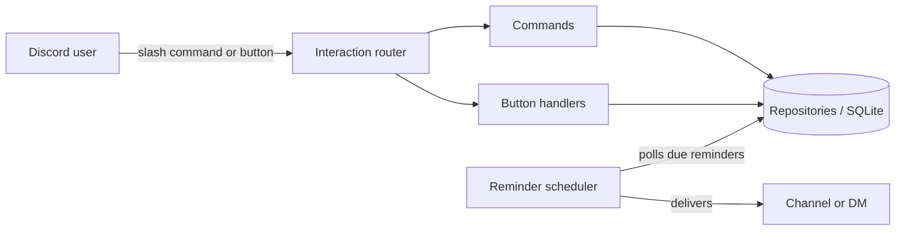

<h1 align="center">Lembrabot</h1>

<p align="center">
  A Discord bot for reminders and polls, built with slash commands, TypeScript and SQLite.
</p>

<p align="center">
  <a href="https://github.com/VitorBernalRodrigues/lembrabot/actions/workflows/ci.yml"></a>
  
  
  
  <a href="LICENSE"></a>
</p>

<p align="center">
  English | <a href="README.pt-BR.md">Português</a>
</p>

<!-- Demo: add a recording at docs/demo.gif and replace this comment with  -->

## Table of contents

- [Features](#features)
- [Commands](#commands)
- [Tech stack](#tech-stack)
- [Getting started](#getting-started)
- [Configuration](#configuration)
- [Project structure](#project-structure)
- [Architecture](#architecture)
- [Testing](#testing)
- [Roadmap](#roadmap)
- [Contributing](#contributing)
- [License](#license)

## Features

- **Persistent reminders.** Reminders are stored in SQLite, so they survive restarts. Anything that came due while the bot was offline is delivered as soon as it is back.
- **Flexible durations.** `10m`, `2h`, `1d12h`, `1w` and combinations like `1h 30m`.
- **DM fallback.** If the original channel is deleted or the bot loses access, the reminder is sent as a direct message.
- **Button-based polls.** Live progress bars, one vote per user (click another option to change it, click the same one to remove it) and an author-only close button that announces the winner or a tie.
- **Ephemeral responses** for anything that only matters to the person who ran the command.
- **No privileged intents.** Only the `Guilds` intent is required, so the bot can join any server without extra verification.

The bot's user-facing messages are in Brazilian Portuguese.

## Commands

| Command | Description |
| --- | --- |
| `/lembrete criar quando:<duration> mensagem:<text>` | Schedules a reminder |
| `/lembrete listar` | Lists your pending reminders |
| `/lembrete cancelar id:<number>` | Cancels one of your pending reminders |
| `/enquete pergunta:<text> opcoes:<a; b; c>` | Creates a poll with 2 to 10 options |
| `/ping` | Shows round-trip and WebSocket latency |
| `/ajuda` | Lists all commands |

## Tech stack

| Area | Tools |
| --- | --- |
| Runtime | Node.js 22, TypeScript (strict mode, ES modules) |
| Discord | discord.js v14 |
| Persistence | SQLite via better-sqlite3, versioned migrations |
| Validation | Zod |
| Quality | Vitest, ESLint, typescript-eslint |
| CI | GitHub Actions |

## Getting started

### Prerequisites

- Node.js 22.12 or newer
- An application created in the [Discord Developer Portal](https://discord.com/developers/applications)

### Installation

```bash
git clone https://github.com/VitorBernalRodrigues/lembrabot.git
cd lembrabot
npm install
cp .env.example .env
```

Fill in `DISCORD_TOKEN` and `DISCORD_CLIENT_ID` in `.env`, then register the slash commands:

```bash
npm run deploy-commands
```

Start the bot:

```bash
npm run dev                 # development, restarts on file changes
npm run build && npm start  # production build
```

### Inviting the bot

In the Developer Portal, open **OAuth2 > URL Generator**, select the `bot` and `applications.commands` scopes and the **Send Messages** permission, then open the generated URL.

## Configuration

| Variable | Required | Default | Description |
| --- | --- | --- | --- |
| `DISCORD_TOKEN` | Yes | | Bot token |
| `DISCORD_CLIENT_ID` | Yes | | Application ID |
| `DISCORD_GUILD_ID` | No | | Registers commands to a single guild instantly. Leave empty to register globally |
| `DATABASE_PATH` | No | `./data/lembrabot.db` | SQLite database file |
| `REMINDER_CHECK_INTERVAL_SECONDS` | No | `15` | How often the scheduler looks for due reminders (minimum 5) |

Configuration is validated on startup, and missing or invalid values produce a clear error message.

## Project structure

```
src/
├── index.ts               # Client setup, interaction router and scheduler bootstrap
├── deploy-commands.ts     # Slash command registration
├── config.ts              # Environment validation
├── types.ts               # Command, button handler and context contracts
├── commands/              # One file per slash command
├── interactions/          # Interaction router and button handlers
├── services/              # Reminder scheduler
├── db/                    # Connection, migrations and repositories
└── utils/                 # Duration parsing and poll rendering
tests/                     # Unit tests (in-memory SQLite)
```

## Architecture



### Design decisions

- **Repository layer.** Commands never touch SQL directly. They depend on `ReminderRepository` and `PollRepository`, which keeps business rules testable without Discord and makes it straightforward to move them behind an HTTP API later.
- **Dependency injection.** Handlers receive a `Context` object instead of importing module-level singletons. The clock is injected as well, so tests control time without timers or sleeps.
- **Database polling instead of one `setTimeout` per reminder.** In-memory timers are lost on restart and cannot represent long delays. Polling a partial index (`WHERE delivered_at IS NULL`) every few seconds is cheap and simple to reason about.
- **Failure isolation.** A failed delivery is logged and marked as processed, so one broken channel never blocks the queue or causes infinite retries.
- **Lightweight migrations.** Schema versions are tracked with SQLite's `user_version` pragma, without an ORM.

## Testing

```bash
npm test            # run the test suite
npm run test:watch  # watch mode
npm run lint        # ESLint
npm run typecheck   # TypeScript
```

The suite covers duration parsing, database migrations, both repositories, voting rules, the scheduler (including delivery failures), poll rendering, configuration and slash command payloads. Every push and pull request runs lint, type checking, tests and the build on GitHub Actions.

## Roadmap

- [x] Slash commands, reminders and polls with SQLite persistence
- [ ] REST API with authentication, consumed by the bot
- [ ] Web dashboard with Discord login
- [ ] AI-powered automations, such as daily channel summaries
- [ ] Docker images and continuous deployment
- [ ] AI assistant that answers questions about server documents and acts through the API

## Contributing

Contributions are welcome. Please read [CONTRIBUTING.md](CONTRIBUTING.md) before opening an issue or pull request.

## License

Distributed under the MIT License. See [LICENSE](LICENSE) for details.

## Author

**Vitor Bernal Rodrigues** · [GitHub](https://github.com/VitorBernalRodrigues)
