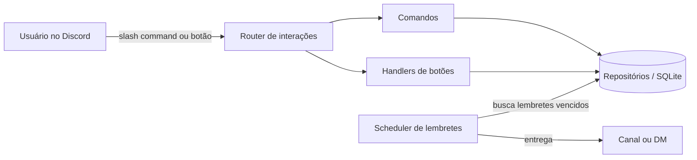

<h1 align="center">Lembrabot</h1>

<p align="center">
  Bot de Discord para lembretes e enquetes, feito com slash commands, TypeScript e SQLite.
</p>

<p align="center">
  <a href="https://github.com/VitorBernalRodrigues/lembrabot/actions/workflows/ci.yml"></a>
  
  
  
  <a href="LICENSE"></a>
</p>

<p align="center">
  <a href="README.md">English</a> | Português
</p>

<!-- Demonstração: adicione uma gravação em docs/demo.gif e troque este comentário por  -->

## Sumário

- [Funcionalidades](#funcionalidades)
- [Comandos](#comandos)
- [Tecnologias](#tecnologias)
- [Como rodar](#como-rodar)
- [Configuração](#configuração)
- [Estrutura do projeto](#estrutura-do-projeto)
- [Arquitetura](#arquitetura)
- [Testes](#testes)
- [Roadmap](#roadmap)
- [Contribuindo](#contribuindo)
- [Licença](#licença)

## Funcionalidades

- **Lembretes persistentes.** Ficam salvos no SQLite e sobrevivem a reinícios. O que venceu enquanto o bot estava fora é entregue assim que ele volta.
- **Durações flexíveis.** `10m`, `2h`, `1d12h`, `1w` e combinações como `1h 30m`.
- **Envio por DM como alternativa.** Se o canal original for apagado ou o bot perder acesso, o lembrete vai por mensagem direta.
- **Enquetes com botões.** Barras de progresso atualizadas a cada voto, um voto por pessoa (clicar em outra opção troca, clicar na mesma remove) e botão de encerrar exclusivo do autor, que mostra a vencedora ou o empate.
- **Respostas privadas (ephemeral)** para tudo que só interessa a quem usou o comando.
- **Sem intents privilegiadas.** Só a intent `Guilds` é necessária, então o bot entra em qualquer servidor sem verificação extra.

## Comandos

| Comando | Descrição |
| --- | --- |
| `/lembrete criar quando:<duração> mensagem:<texto>` | Agenda um lembrete |
| `/lembrete listar` | Lista os seus lembretes pendentes |
| `/lembrete cancelar id:<número>` | Cancela um lembrete pendente seu |
| `/enquete pergunta:<texto> opcoes:<a; b; c>` | Cria uma enquete com 2 a 10 opções |
| `/ping` | Mostra a latência de ida e volta e do WebSocket |
| `/ajuda` | Lista todos os comandos |

## Tecnologias

| Área | Ferramentas |
| --- | --- |
| Runtime | Node.js 22, TypeScript (modo strict, ES modules) |
| Discord | discord.js v14 |
| Persistência | SQLite com better-sqlite3 e migrações versionadas |
| Validação | Zod |
| Qualidade | Vitest, ESLint, typescript-eslint |
| CI | GitHub Actions |

## Como rodar

### Pré-requisitos

- Node.js 22.12 ou mais recente
- Uma aplicação criada no [Discord Developer Portal](https://discord.com/developers/applications)

### Instalação

```bash
git clone https://github.com/VitorBernalRodrigues/lembrabot.git
cd lembrabot
npm install
cp .env.example .env
```

Preencha `DISCORD_TOKEN` e `DISCORD_CLIENT_ID` no `.env` e registre os slash commands:

```bash
npm run deploy-commands
```

Suba o bot:

```bash
npm run dev                 # desenvolvimento, reinicia ao salvar
npm run build && npm start  # build de produção
```

### Convidando o bot

No Developer Portal, abra **OAuth2 > URL Generator**, marque os escopos `bot` e `applications.commands` e a permissão **Send Messages**, e abra a URL gerada.

## Configuração

| Variável | Obrigatória | Padrão | Descrição |
| --- | --- | --- | --- |
| `DISCORD_TOKEN` | Sim | | Token do bot |
| `DISCORD_CLIENT_ID` | Sim | | ID da aplicação |
| `DISCORD_GUILD_ID` | Não | | Registra os comandos na hora em um único servidor. Vazio registra globalmente |
| `DATABASE_PATH` | Não | `./data/lembrabot.db` | Arquivo do banco SQLite |
| `REMINDER_CHECK_INTERVAL_SECONDS` | Não | `15` | Intervalo em que o scheduler procura lembretes vencidos (mínimo 5) |

A configuração é validada na inicialização, e valores ausentes ou inválidos geram uma mensagem de erro clara.

## Estrutura do projeto

```
src/
├── index.ts               # Client, router de interações e scheduler
├── deploy-commands.ts     # Registro dos slash commands
├── config.ts              # Validação das variáveis de ambiente
├── types.ts               # Contratos de comandos, botões e contexto
├── commands/              # Um arquivo por slash command
├── interactions/          # Router de interações e handlers de botões
├── services/              # Scheduler de lembretes
├── db/                    # Conexão, migrações e repositórios
└── utils/                 # Parser de duração e renderização das enquetes
tests/                     # Testes unitários (SQLite em memória)
```

## Arquitetura



### Decisões técnicas

- **Camada de repositórios.** Os comandos não escrevem SQL. Eles dependem de `ReminderRepository` e `PollRepository`, o que deixa as regras de negócio testáveis sem o Discord e facilita colocá-las atrás de uma API HTTP depois.
- **Injeção de dependências.** Os handlers recebem um objeto `Context` em vez de importar singletons. O relógio também é injetado, então os testes controlam o tempo sem timers.
- **Polling no banco em vez de um `setTimeout` por lembrete.** Timers em memória se perdem ao reiniciar e não suportam prazos longos. Consultar um índice parcial (`WHERE delivered_at IS NULL`) a cada poucos segundos é barato e fácil de entender.
- **Isolamento de falhas.** Uma entrega com erro é registrada no log e marcada como processada, então um canal quebrado nunca trava a fila nem gera tentativas infinitas.
- **Migrações leves.** A versão do schema fica no `user_version` do SQLite, sem ORM.

## Testes

```bash
npm test            # roda os testes
npm run test:watch  # modo watch
npm run lint        # ESLint
npm run typecheck   # TypeScript
```

Os testes cobrem o parser de duração, as migrações do banco, os dois repositórios, as regras de votação, o scheduler (incluindo falhas de entrega), a renderização das enquetes, a configuração e os payloads dos slash commands. Cada push e pull request roda lint, checagem de tipos, testes e build no GitHub Actions.

## Roadmap

- [x] Slash commands, lembretes e enquetes com persistência em SQLite
- [ ] API REST com autenticação, consumida pelo bot
- [ ] Painel web com login pelo Discord
- [ ] Automações com IA, como resumo diário de canais
- [ ] Imagens Docker e deploy contínuo
- [ ] Assistente de IA que responde sobre documentos do servidor e age pela API

## Contribuindo

Contribuições são bem-vindas. Leia o [CONTRIBUTING.md](CONTRIBUTING.md) antes de abrir uma issue ou pull request.

## Licença

Distribuído sob a licença MIT. Veja [LICENSE](LICENSE).

## Autor

**Vitor Bernal Rodrigues** · [GitHub](https://github.com/VitorBernalRodrigues)
